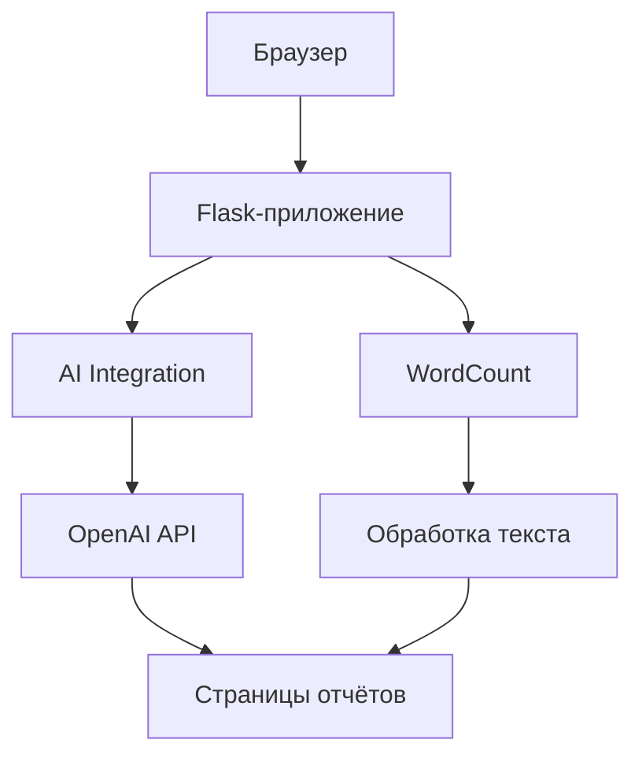

# Syntaxis Helper
Ai tool for those who strive to automate parsing comments from BA and same platforms.

My first encounter with Flask. I used colleage's pattern to create this tool. All further tools are my Flask patterns.

## How it works

1. Пользователь открывает веб‑интерфейс, где Flask подгружает страницы из Markdown и считывает настройки из `settings.txt`.
2. При отправке формы *AI Integration* текст и, при необходимости, файл отправляются на эндпоинт `/static/processing/ai_integration`:
   - загружаемый файл сохраняется и при необходимости конвертируется в `txt`;
   - запрос передается в API OpenAI и после обработки возвращается на страницу `reports/result.html`.
3. При отправке формы *WordCount* данные отправляются на `/static/processing/WordCount`:
   - файл Excel/CSV и список терминов разбираются и лемматизируются;
   - подсчитываются вхождения слов и словосочетаний, формируется облако слов и Excel‑отчет в папке `downloads`;
   - результат отображается на странице `reports/result_1.html`.
4. Готовые отчеты можно скачать через `/download/latest`, который выдает последний созданный файл из каталога `downloads`.

## Архитектура

